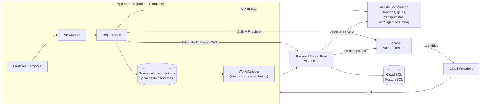

<div align="center">


#  Lince Track

**Coordinación de servicios turísticos entre conductores, guías y coordinación de Southbound (Puerto Varas).**


</div>

---

##  Descripción

**Lince Track** reúne en una app los servicios que Southbound asigna a sus conductores (transportistas) y guías. Cada
persona ve lo suyo, lo acepta o rechaza, hace check-in y check-out en el punto de encuentro y avisa de incidencias.
Coordinación ve toda la operación del día, atiende las incidencias, envía reemplazos y revisa la puntualidad.

Los servicios vienen de la **API de Southbound** (solo lectura). Lo que escribe la app (respuestas, check-ins,
incidencias, reemplazos) vive en **Firebase**, y las reglas que deben validarse en un servidor (geocerca, horario,
disponibilidad) están en un **backend propio en Spring Boot**, publicado en **Google Cloud Run**.

> Proyecto académico (Duoc UC, DSY1105). Los servicios, pasajeros y agencias de la API del curso son ficticios.

##  Funcionalidades

### Conductores y guías
- Lista de servicios asignados (hoy y próximos días), calendario y alertas.
- **Aceptar o rechazar** un servicio con motivo; ver a la otra persona del tour y contactarla por WhatsApp.
- **Check-in con geocerca:** el mapa muestra el punto de recogida, la distancia, el radio, la precisión del GPS y la
  hora límite. El check-in queda **bloqueado** si la persona está fuera de la zona, el GPS es impreciso o ya pasó la
  hora (15 min antes del pickup). La app y el backend validan lo mismo.
- **Sin conexión:** el check-in se guarda en el teléfono (Room) y se envía solo al volver la señal (WorkManager), sin
  duplicarse.
- **Incidencias** (falla mecánica, atraso, pasajeros, camino o clima) con la ubicación del momento.
- Clima de la ruta con recomendaciones de conducción (conductor) o de vestimenta (guía).
- Bloquear días de disponibilidad (con 7 días de anticipación y nunca sobre un servicio asignado).
- Perfil con próximo servicio, puntualidad y servicios terminados.

### Coordinación (administrador)
- **Panel** del día elegido con totales, filtro por estado y por tipo de servicio, incidencias abiertas, rechazos
  próximos y solicitudes de datos.
- **Reemplazos:** reasignar un servicio pendiente o, con una incidencia abierta, uno ya aceptado.
- Responder y resolver incidencias.
- **Resumen** para los dueños: operación de hoy y de los últimos 7 días, datos de Southbound (`/resumen`),
  **puntualidad del equipo** (desde el backend) y equipo de Southbound (`/guias`, `/transportistas`).

### Para todos
- **Notificaciones con la app cerrada** (Cloud Functions + Firebase Cloud Messaging): reemplazos, incidencias nuevas,
  respuestas de Coordinación y rechazos. Al tocarlas se abre el servicio.
- **Español e inglés**, con selector persistente.
- Tema claro, oscuro o del sistema.
- **Privacidad (Ley 21.719):** aviso de privacidad, descarga de los propios datos y solicitud de eliminación, que
  Coordinación aprueba o rechaza.

##  Arquitectura



| Pieza | Qué hace | Dónde |
| --- | --- | --- |
| **App Android** | Pantallas, validación local de la geocerca, cola sin conexión | `app/` |
| **API de Southbound** | Servicios, guías, transportistas, catálogos y resumen (solo lectura) | Externa (curso) |
| **Firebase** | Login, roles, respuestas, check-ins, incidencias, reemplazos, tokens de notificación | `firestore.rules` |
| **Backend propio** | Geocercas, hitos (check-in/out validados), bloqueos, parámetros, puntualidad, privacidad | `backend/` (Cloud Run + Cloud SQL) |
| **Cloud Functions** | Notificaciones con la app cerrada y borrado de datos aprobado | `functions/` |

- **Swagger del backend:** https://lince-backend-589632568586.southamerica-west1.run.app/swagger-ui.html (botón
  *Authorize* con un token de Firebase). Detalle de endpoints, reglas y tests en [`backend/README.md`](backend/README.md).
- **Seguridad:** el backend no tiene login propio; valida el token de Firebase Auth y toma el rol de sus *custom
  claims*. Las reglas de Firestore niegan todo lo que no está permitido explícitamente.

##  Tecnologías utilizadas

| Área | Tecnología |
| --- | --- |
| App | Kotlin 2.2.10, Jetpack Compose + Material 3, Navigation Compose 2.10.2 |
| Build | Gradle 9.5, AGP 9.3.3, KSP, compileSdk/targetSdk 37, minSdk 27 |
| Red | Retrofit 3.0.0 + kotlinx.serialization 1.9.0 |
| Local | Room 2.8 (cola y caché), WorkManager 2.12 (sincronización), DataStore (preferencias) |
| Mapa y ubicación | osmdroid (OpenStreetMap), Play Services Location |
| Firebase | Auth, Firestore, Cloud Messaging, Cloud Functions (Node 22) |
| Backend | Spring Boot 4.1 (Java 21), Spring Security (JWT de Firebase), JPA, Swagger/OpenAPI |
| Base de datos | PostgreSQL 17 en Cloud SQL (H2 para desarrollo local) |
| Nube | Google Cloud Run, Cloud SQL, Secret Manager (región `southamerica-west1`, Santiago) |
| Clima | Open-Meteo |
| Pruebas | JUnit 4 y 5, MockK, Mockito, Compose UI Test, JaCoCo, emulador de Firestore, `node --test` |

##  Planificación del Proyecto

Para llevar un control de las tareas, pendientes y avances del proyecto utilizamos **Trello**.

[](https://trello.com/invite/b/6adb4d7f1dcb5139510fb058/ATTI72f8bfc1875b16743e30d6cfd2711b7e4DC0D4F1/lincetrack)

##  Cómo ejecutar

### Requisitos
- **Android Studio** (última versión) con el **Android SDK**.
- **JDK 21 o superior** (sirve el `jbr` que trae Android Studio).
- Un **celular Android** (8.1 o superior) conectado por USB, con la depuración USB activada.

### Configuración local (`local.properties`, fuera de Git)

```properties
sdk.dir=C\:\\Users\\<usuario>\\AppData\\Local\\Android\\Sdk
# Clave de la API de Southbound (la entrega el docente). Sin ella, la app usa datos de ejemplo.
LINCE_API_KEY=<clave del curso>
# Opcional: backend local en vez del de Cloud Run (con adb reverse tcp:8080 tcp:8080).
# LINCE_BACKEND_URL=http://localhost:8080/
```

La app usa por defecto el backend publicado en Cloud Run, así que no hace falta levantarlo para probarla.

### App — Android Studio
1. **Open** → carpeta del proyecto y esperar la sincronización de Gradle.
2. Conectar el celular y pulsar **Run ▶**.

### App — Terminal

```powershell
git clone https://github.com/Shir1n/Lince_Track.git
cd Lince_Track
.\gradlew.bat assembleDebug     # APK en app/build/outputs/apk/debug/app-debug.apk
.\gradlew.bat installDebug      # instala en el celular conectado
```

En macOS o Linux se usa `./gradlew` en vez de `.\gradlew.bat`.

### Cuentas de prueba

Las cuentas de cada rol (conductor, guía y administrador) están en [`USUARIOS_TEST.md`](USUARIOS_TEST.md), y la pantalla
de login tiene botones que las rellenan.

### Backend (opcional, para desarrollo)

```powershell
cd backend
$env:JAVA_HOME = "C:\Program Files\Android\Android Studio\jbr"
$env:LINCE_API_KEY = "<clave del curso>"
.\gradlew.bat bootRun           # http://localhost:8080/swagger-ui.html, con H2 en backend/data/
```

Con Docker (PostgreSQL): `docker compose up --build` dentro de `backend/`. Publicar en Cloud Run:
`gcloud run deploy lince-backend --source . --region southamerica-west1`. Más detalle en
[`backend/README.md`](backend/README.md).

### Reglas de Firestore y Cloud Functions

```powershell
.\firestore-tests\node_modules\.bin\firebase deploy --only firestore:rules,functions
```

Necesita `npx firebase login` con la cuenta dueña del proyecto y el plan Blaze de Firebase.

### APK release firmada

La firma de release usa una keystore (`.jks`) que **no está en el repositorio**. Sus datos se leen de
`local.properties`:

```properties
LINCE_RELEASE_STORE_FILE=D:/ruta/fuera/del/repo/lince-release.jks
LINCE_RELEASE_STORE_PASSWORD=...
LINCE_RELEASE_KEY_ALIAS=lince-release
LINCE_RELEASE_KEY_PASSWORD=...
```

```powershell
.\gradlew.bat assembleRelease
```

La APK queda en `app/build/outputs/apk/release/app-release.apk`. Para comprobar la firma (con las build-tools del SDK):

```powershell
& "$env:LOCALAPPDATA\Android\Sdk\build-tools\36.0.0\apksigner.bat" verify --print-certs app\build\outputs\apk\release\app-release.apk
```

Debe decir `Signer #1 certificate DN: CN=Lince Track, OU=DSY1105, ...`. Sin esos datos, `assembleRelease` igual
compila, pero la APK sale sin firmar. Un celular con la versión debug instalada no acepta la release encima (firma
distinta): hay que desinstalar primero. Para que la APK use datos reales, `local.properties` también debe tener
`LINCE_API_KEY`.

##  Pruebas

| Suite | Qué prueba | Cómo se corre | Resultado (23-11-2026) |
| --- | --- | --- | --- |
| **App — unitarias** | Reglas (geocerca, check-in, compañero de tour, reemplazos, incidencias), repositorios y ViewModel con Firebase, el backend y la API simulados (JUnit + MockK) | `.\gradlew.bat testDebugUnitTest` | **327 tests**, todos pasan |
| **App — cobertura** | Líneas de las clases `*Repository` y `*ViewModel` (la pauta pide más de 90 %) | `.\gradlew.bat jacocoPautaReport` | **93,9 %** de líneas |
| **App — Compose UI** | Bloqueo de días en el calendario y perfiles (en un celular conectado) | `.\gradlew.bat connectedDebugAndroidTest` | `CalendarioBloqueoUiTest`, `PerfilesUiTest` |
| **Backend** | Reglas de hitos y bloqueos, endpoints con H2, API de Southbound y Firestore simulados, seguridad por rol, privacidad | `cd backend; .\gradlew.bat test` | **89 tests**, **96 %** de líneas y 83 % de ramas |
| **Reglas de Firestore** | Qué puede leer y escribir cada rol en cada colección, con el emulador | `cd firestore-tests; npm install; npm test` | **128 tests**, todos pasan |
| **Cloud Functions** | Qué notificación se envía y a quién, y el borrado de datos aprobado | `cd functions; npm install; npm test` | **15 tests**, todos pasan |

Los reportes quedan en:
- `app/build/reports/tests/testDebugUnitTest/index.html` (tests de la app)
- `app/build/reports/jacoco/jacocoPautaReport/html/index.html` (cobertura de la app)
- `backend/build/reports/tests/test/index.html` y `backend/build/reports/jacoco/test/html/index.html` (backend)

Además se probó en celulares reales: check-in bloqueado por radio, check-in en modo avión sincronizado al volver la
señal, notificación con el celular bloqueado y eliminación de datos de punta a punta.

##  Privacidad

La app sigue la Ley 21.719 de protección de datos personales:
- **Aviso** "Tus datos en Lince Track" al abrir la app (qué datos, para qué, quién los ve, dónde se guardan).
- La ubicación solo se lee con el mapa abierto, y solo se guarda en el check-in, el check-out y las incidencias. La
  pantalla nunca muestra coordenadas.
- En **Ajustes → Privacidad** cada persona **descarga sus datos** (JSON) y **pide su eliminación**. Si Coordinación la
  aprueba, se borran sus datos en Firestore, el backend y la cuenta.

##  Estructura

```text
Lince_Track/
├── app/src/main/java/com/example/lince_track/
│   ├── data/          Repositorios, reglas de negocio, modelos
│   │   ├── local/     Room (cola de check-ins y caché)
│   │   ├── remote/    Retrofit: API de Southbound y backend propio
│   │   ├── servicios/ Fuente de servicios (API o datos de ejemplo)
│   │   └── privacidad/ Aviso, descarga y eliminación de datos
│   ├── ui/            Pantallas Compose (servicios, guía, detalle, ruta/mapa,
│   │                  calendario, alertas, perfil, admin, ajustes…)
│   └── util/          Logs, notificaciones, sincronización (WorkManager)
├── backend/           Spring Boot: geocercas, hitos, bloqueos, parámetros, privacidad
├── functions/         Cloud Functions (notificaciones y borrado de datos)
├── firestore.rules    Reglas de seguridad de Firestore
└── firestore-tests/   Tests de las reglas con el emulador
```

##  Identidad visual

El **lince** simboliza agilidad, visión y adaptabilidad; las **montañas** representan
el turismo en Chile y la conexión con la naturaleza.

| Color | HEX | Uso |
| --- | --- | --- |
| Principal | `#0F2B48` | Top bars y botones principales |
| Secundario | `#0A8F82` | Acentos y acciones (Confirmar) |
| Advertencia | `#C67A18` | Estados "Pendiente" |
| Fondo | `#F8FAFC` | Fondo general |
| Texto | `#0F172A` | Textos principales |

##  Integrantes

| Integrante | Rol |
| --- | --- |
| Shir1n | Coordinación técnica: Firebase, backend, nube e integración |
| Benjamin Agüero | Frontend |
| Luciano Garrido | Backend y panel de Coordinación |
| Raúl Ferrini | Frontend (mapa) |
| Ignacio Salazar | Scrum Master |
